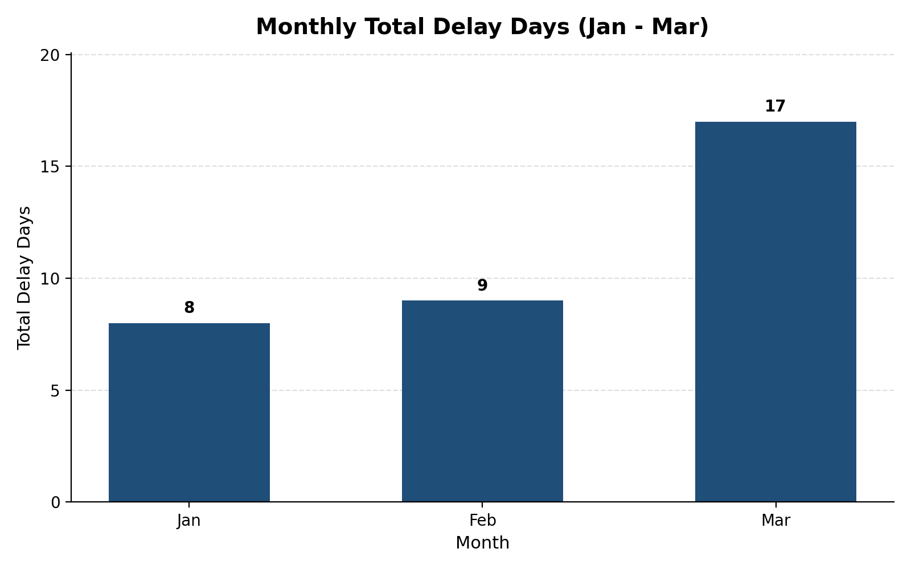

# Delivery Delay Analysis — Set A

**Student Name:** [Your Name]  
**Student ID:** [Your Student ID]  
**Assigned Set:** Set A  
**Project Focus:** Excel • SQL • Python • Power BI  
**Business Question:** Which service type has the greatest delivery-delay burden, and which hub needs priority attention?

---

## Table of Contents

1. [Project Overview](#1-project-overview)
2. [Business Problem and Objectives](#2-business-problem-and-objectives)
3. [Dataset Description](#3-dataset-description)
4. [Data Quality and Cleaning](#4-data-quality-and-cleaning)
5. [Metric Definitions](#5-metric-definitions)
6. [Project Structure](#6-project-structure)
7. [Tools and Technologies](#7-tools-and-technologies)
8. [Analysis Results and Findings](#8-analysis-results-and-findings)
9. [Python Chart](#9-python-chart)
10. [Excel Implementation](#10-excel-implementation)
11. [SQL Implementation](#11-sql-implementation)
12. [Python Implementation](#12-python-implementation)
13. [Power BI Implementation](#13-power-bi-implementation)
14. [Cross-Tool Reconciliation](#14-cross-tool-reconciliation)
15. [Setup and Run Instructions](#15-setup-and-run-instructions)
16. [Power BI Refresh Instructions](#16-power-bi-refresh-instructions)
17. [Interpretation, Recommendation, and Limitation](#17-interpretation-recommendation-and-limitation)
18. [Video Explanation](#18-video-explanation)
19. [References and Authorship](#19-references-and-authorship)
20. [Final Reproducibility Checklist](#20-final-reproducibility-checklist)

---

## 1. Project Overview

Delivery Delay Analysis examines a small synthetic delivery dataset covering January, February, and March. It combines a delivery fact table with a route lookup table, removes an intentional duplicate record, derives delay days, and compares the resulting delivery-delay burden by service type, route, hub, and month.

The project uses four tools:

- **Excel** for data cleaning, lookup formulas, summary calculations, a PivotTable, and a chart.
- **SQL** for relational table creation, data integrity checks, and analytical queries.
- **Python** for reproducible loading, cleaning, merging, calculations, visualization, and CSV exports.
- **Power BI** for a relationship-based data model, DAX measures, KPI cards, charts, and a hub slicer.

The analysis uses only the synthetic records provided for Set A. The supplied raw delivery file contains 13 rows because one row is an intentional exact duplicate. After removing that duplicate, the analysis uses **12 unique delivery records** and **4 route lookup records**.

## 2. Business Problem and Objectives

### Business problem

A delivery operation needs to understand where accumulated delivery delays are concentrated. Total delay days by service type help compare Express and Standard services, while hub-level totals help prioritize operational investigation.

The analysis answers these two business questions:

1. **Which service type has the greatest delivery-delay burden?**
2. **Which hub needs priority attention based on total delay days?**

### Objectives

- Preserve the supplied raw values and retain a raw copy for traceability.
- Remove the exact duplicate from the delivery fact data.
- Use `route_id` to map each delivery record to its route and service type.
- Calculate `delay_days` consistently across all tools.
- Calculate service-level delay incidence from record counts, not from averaging subgroup percentages.
- Compare delay totals by service type, route, hub, and month.
- Build a monthly chart with months ordered **Jan → Feb → Mar**.
- Reconcile at least one aggregate across Excel, SQL, Python, and Power BI.
- Document the workflow so another person can reproduce the analysis.

## 3. Dataset Description

Two CSV files form the project dataset.

### `data/raw/deliveries.csv` — fact table

The original file has **13 data rows**, including one intentional exact duplicate. The clean version has **12 unique records**.

| Column | Type | Meaning |
|---|---|---|
| `record_id` | Integer | Identifier supplied for a delivery summary record |
| `month` | Text / ordered category | Reporting month: Jan, Feb, or Mar |
| `route_id` | Text | Route key used to join to the routes lookup |
| `hub` | Text | Hub associated with the delivery summary |
| `promised_days` | Numeric | Promised delivery duration in days |
| `actual_days` | Numeric | Actual delivery duration in days |

Each row is a **month-end route/hub delivery summary**. The sum of `delay_days` represents cumulative record-level delay; it does not represent a list of unique parcels that need to be expedited today.

### `data/raw/routes.csv` — lookup table

This file contains four route records.

| `route_id` | `route` | `service_type` |
|---|---|---|
| R1 | Metro Link | Express |
| R2 | City Dash | Express |
| R3 | Highway Freight | Standard |
| R4 | Rural Feeder | Standard |

| Column | Type | Meaning |
|---|---|---|
| `route_id` | Text | Unique route key |
| `route` | Text | Route name |
| `service_type` | Text | Service category: Express or Standard |

### Relationship

`routes.route_id` is the lookup key and `deliveries.route_id` is the fact-table foreign key. One route can have multiple delivery records, so the relationship is **one-to-many from routes to deliveries**.

## 4. Data Quality and Cleaning

The same cleaning rules are applied consistently across the four tools.

1. Import the raw delivery data without changing the supplied values.
2. Keep the original 13-row file in the `Raw` worksheet and in `data/raw/`.
3. Identify and remove the intentional exact duplicate:
   - `12,Mar,R4,Mumbai,6,15`
4. Confirm that the clean delivery table contains exactly **12 rows**.
5. Load the four-row routes lookup.
6. Merge the clean deliveries with routes on `route_id`.
7. Confirm that all delivery route keys match a lookup row and that no `service_type` values are missing after the merge.
8. Confirm numeric types for `promised_days` and `actual_days`; keep identifiers and service type as text.
9. Preserve month ordering as **Jan → Feb → Mar** in charts, pivots, and reports.

### Data integrity checks

| Check | Expected / observed result |
|---|---:|
| Raw delivery rows | 13 |
| Exact duplicate rows removed | 1 |
| Clean delivery rows | 12 |
| Route lookup rows | 4 |
| Unmatched route IDs after merge | 0 |
| Missing `service_type` values after merge | 0 |

## 5. Metric Definitions

### Delay days

For every delivery record:

```text
delay_days = MAX(actual_days - promised_days, 0)
```

A delivery that is on time or early receives zero delay days. Negative delay values are not retained.

**Excel formula concept:** `=MAX(actual_days-promised_days,0)`  
**Python formula:** `(df["actual_days"] - df["promised_days"]).clip(lower=0)`  
**SQL concept:** `CASE WHEN actual_days > promised_days THEN actual_days - promised_days ELSE 0 END`

### Total delay days

The sum of `delay_days` across the records included in the selected group.

### Delay incidence rate

```text
Delay Incidence Rate =
Number of records where actual_days > promised_days
÷
Total number of records
```

Display the result as a percentage. Calculate it from the underlying counts; do not average subgroup percentages.

### Month ordering

The month field is ordered categorically as:

```text
Jan → Feb → Mar
```

### Reporting precision

Report numeric results to **two decimal places** where appropriate. If a query or grouping produces a tie for highest or lowest, report all tied entities.

## 6. Project Structure

The following structure is the intended GitHub repository layout. Keep the actual files in the same locations so that relative paths work on another computer.

```text
data-analysis-set-a-YOUR-STUDENT-ID/
├── README.md
├── requirements.txt
├── .gitignore
├── data/
│   └── raw/
│       ├── deliveries.csv
│       └── routes.csv
├── excel/
│   └── analysis.xlsx
├── sql/
│   ├── setup.sql
│   └── queries.sql
├── python/
│   └── analysis.py
├── powerbi/
│   └── dashboard.pbix
├── outputs/
│   ├── clean_data.csv
│   ├── python_summary.csv
│   ├── python_chart.png
│   ├── powerbi_dashboard.png
│   └── sql/
│       ├── s2a_delay_by_service_type.csv
│       ├── s2b_routes_over_8_delay_days.csv
│       └── s2c_top_two_hubs.csv
└── Assets/
    └── python_chart.png
```

`Assets/python_chart.png` is the chart image embedded in this README. The expected deliverable chart path from the project specification is `outputs/python_chart.png`; keep a copy there as well when preparing the final repository. The paths above describe the intended deliverables—verify that every file exists and opens before submission.

## 7. Tools and Technologies

| Tool | Purpose |
|---|---|
| Microsoft Excel | Raw/lookup/clean/summary worksheets, lookup formulas, `MAX` formula, `SUMIFS`, PivotTable, column chart |
| SQL engine | Relational schema, primary/foreign keys, analytical queries, integrity diagnostics |
| Python | Data loading, deduplication, merge validation, derived metrics, grouped summary, chart, CSV exports |
| Pandas | Tabular data preparation and aggregation |
| Matplotlib | Monthly delay chart |
| Power BI Desktop | Power Query, model relationship, DAX measures, KPI cards, charts, hub slicer |
| Git / GitHub | Version control and public project repository |

Record the exact versions used in the final repository. For SQL, identify the engine and version (for example, MySQL or SQL Server); do not leave the version undocumented.

## 8. Analysis Results and Findings

### 8.1 Monthly total delay days

| Month | Total delay days |
|---|---:|
| Jan | 8 |
| Feb | 9 |
| Mar | 17 |
| **Total** | **34** |

### 8.2 Total delay days by service type

| Service type | Total delay days | Delay incidence rate |
|---|---:|---:|
| Express | 12 | 66.67% |
| Standard | 22 | 83.33% |
| **Overall** | **34** | **75.00%** |

Standard has the greatest delay burden: **22 of 34 total delay days**, or **64.71%** of all delay days. Its delay incidence rate is 83.33% (5 of 6 records), compared with 66.67% (4 of 6 records) for Express.

### 8.3 Total delay days by route

| Route ID | Route | Service type | Total delay days |
|---|---|---|---:|
| R1 | Metro Link | Express | 9 |
| R2 | City Dash | Express | 3 |
| R3 | Highway Freight | Standard | 8 |
| R4 | Rural Feeder | Standard | 14 |
| **Total** |  |  | **34** |

**R4 — Rural Feeder** has the greatest summed route delay: **14 days**, equal to **41.18%** of the overall 34 delay days.

### 8.4 Total delay days by hub

| Hub | Total delay days |
|---|---:|
| Chennai | 5 |
| Delhi | 14 |
| Mumbai | 15 |
| **Total** | **34** |

Mumbai has the highest hub total at **15 delay days**, narrowly ahead of Delhi at 14. Mumbai is therefore the first hub to investigate based on total delay days in this dataset.

### 8.5 Routes whose summed delay exceeds 8 days

| Route ID | Route | Total delay days |
|---|---|---:|
| R1 | Metro Link | 9 |
| R4 | Rural Feeder | 14 |

### 8.6 Top two hubs

1. Mumbai — 15 delay days
2. Delhi — 14 delay days

There is no tie for either position in the supplied dataset.

## 9. Python Chart

The monthly bar chart compares the total delay days recorded in January, February, and March.



**Chart file:** `Assets/python_chart.png`  
**Required deliverable path:** `outputs/python_chart.png`

### Chart interpretation

- January recorded **8** delay days.
- February recorded **9** delay days, one more than January.
- March recorded **17** delay days, eight more than February.
- March represents **50.00%** of the total 34 delay days in the three-month period.

The monthly increase is a signal to investigate, not proof of a particular cause. The dataset contains monthly route/hub summaries rather than individual parcel-level delivery events.

## 10. Excel Implementation

The workbook is saved as `excel/analysis.xlsx` and contains four worksheets.

### `Raw`

- Contains the original 13 delivery rows exactly as supplied.
- Retains the intentional duplicate so the cleaning step is traceable.
- Clearly labels the before-cleaning row count as 13.

### `Lookup`

- Contains the four rows from `routes.csv`.
- Provides `route_id`, route name, and service type for lookup formulas.

### `Clean`

- Contains 12 unique delivery records after duplicate removal.
- Clearly labels the before count (13) and after count (12).
- Uses `XLOOKUP` or `INDEX/MATCH` to populate `service_type` from `Lookup` by `route_id`.
- Includes the calculated `delay_days` field using the `MAX` rule.
- Uses appropriate data types for identifiers, text, and numeric columns.

Example formula concept:

```excel
=MAX([@actual_days]-[@promised_days],0)
```

Example lookup concept:

```excel
=XLOOKUP([@route_id],Lookup!A:A,Lookup!C:C,"Not found")
```

Adjust cell and column references to match the actual workbook layout.

### `Summary`

- Uses `SUMIFS` to calculate total delay days for Chennai, Delhi, and Mumbai.
- Includes a PivotTable with `service_type` as rows and `month` as columns.
- Keeps month columns ordered Jan, Feb, Mar.
- Includes a column chart with a descriptive title, labeled axes, and legend.
- Keeps formulas and the PivotTable editable.

## 11. SQL Implementation

The SQL deliverables are:

- `sql/setup.sql`
- `sql/queries.sql`

### Setup and integrity

`setup.sql` creates the `deliveries` and `routes` tables with suitable data types, keys, and a relationship from `deliveries.route_id` to `routes.route_id`. It loads **12 clean delivery rows** and **4 route lookup rows**, excluding the duplicate from the SQL fact table.

The selected SQL engine and version should be documented in a comment at the top of `setup.sql` and in this README.

### Analytical queries

`queries.sql` contains the following labeled queries:

- **S2a — Total delay days by service type:** joins deliveries to routes, calculates delay days, and sorts total delay days in descending order.
- **S2b — Routes with significant delay:** groups by route and returns routes whose summed delay exceeds 8 days.
- **S2c — Top two hubs by delay:** returns the two hubs with the highest summed delay; alphabetical hub order is used to break any ties.

It also includes a diagnostic `LEFT JOIN` query to check that every delivery `route_id` matches a row in the routes lookup. The expected number of unmatched route keys is zero.

### Expected analytical results

| Query | Expected result |
|---|---|
| S2a | Standard: 22 delay days; Express: 12 delay days |
| S2b | R4 / Rural Feeder: 14; R1 / Metro Link: 9 |
| S2c | Mumbai: 15; Delhi: 14 |
| Route-key diagnostic | 0 unmatched keys |

Save the query outputs as labeled CSV or text files under `outputs/sql/`. Run `setup.sql` first, then `queries.sql`.

## 12. Python Implementation

The Python deliverable is `python/analysis.py` (or a fully executed notebook if the project uses `.ipynb`). All paths should be relative to the repository root.

### Required workflow

1. Load `data/raw/deliveries.csv` and `data/raw/routes.csv`.
2. Confirm `promised_days` and `actual_days` are numeric.
3. Remove the exact duplicate delivery row.
4. Merge deliveries with routes on `route_id` using a left join.
5. Assert that the merged DataFrame contains exactly 12 rows.
6. Assert that all delivery route IDs matched a lookup row and `service_type` contains no missing values.
7. Calculate `delay_days` using `.clip(lower=0)`.
8. Group by `service_type` to calculate total delay days and delay incidence rate.
9. Identify the route with the highest summed delay and calculate its share of total delay days.
10. Group delay days by month in Jan → Feb → Mar order and plot the result.
11. Export the merged clean dataset, service summary, and chart.

### Expected Python exports

| Output path | Content |
|---|---|
| `outputs/clean_data.csv` | Merged clean data with 12 records and derived fields |
| `outputs/python_summary.csv` | Service-type delay totals and incidence rates |
| `outputs/python_chart.png` | Monthly total delay-days chart |

Expected key values from Python:

- Clean merged rows: **12**
- Unmatched route keys: **0**
- Express total delay days: **12**
- Standard total delay days: **22**
- Highest-delay route: **R4 / Rural Feeder**
- R4 share of overall delay: **41.18%**
- Monthly totals: **Jan 8, Feb 9, Mar 17**

## 13. Power BI Implementation

The Power BI deliverable is `powerbi/dashboard.pbix`.

### Power Query and data model

- Load `deliveries.csv` and `routes.csv`.
- Set appropriate column data types.
- Remove the exact duplicate from deliveries so 12 records remain.
- Create an active one-to-many relationship from `routes[route_id]` to `deliveries[route_id]`.
- Use single-direction filtering from routes to deliveries.

### DAX measures

Create the measures in a dedicated Measures table.

```DAX
Delivery Count =
COUNTROWS(deliveries)
```

```DAX
Total Delay Days =
SUMX(
    deliveries,
    MAX(
        deliveries[actual_days] - deliveries[promised_days],
        0
    )
)
```

```DAX
Delay Incidence Rate =
DIVIDE(
    COUNTROWS(
        FILTER(
            deliveries,
            deliveries[actual_days] > deliveries[promised_days]
        )
    ),
    COUNTROWS(deliveries),
    0
)
```

Format `Delay Incidence Rate` as a percentage.

### Report page

The report page should contain:

- KPI card for Delivery Count;
- KPI card for Total Delay Days;
- KPI card for Delay Incidence Rate;
- bar chart comparing total delay days by service type;
- monthly trend chart sorted Jan → Feb → Mar;
- hub slicer that filters the cards and charts.

Test the hub slicer with a selected hub, record the filtered KPI values for the project walkthrough, then clear the filter and save the unfiltered dashboard screenshot to `outputs/powerbi_dashboard.png`.

### Expected unfiltered KPIs

| KPI | Expected value |
|---|---:|
| Delivery Count | 12 |
| Total Delay Days | 34 |
| Delay Incidence Rate | 75.00% |

## 14. Cross-Tool Reconciliation

Use the same cleaned 12-row dataset and the same metric definition in all tools.

| Aggregate | Excel | SQL | Python | Power BI | Expected value |
|---|---|---|---|---|---:|
| Standard total delay days | PivotTable | S2a | Service summary | Service-type bar chart / filter | 22 |
| Express total delay days | PivotTable | S2a | Service summary | Service-type bar chart / filter | 12 |
| Overall total delay days | Summary formulas | Sum of service totals | Sum of `delay_days` | Total Delay Days measure | 34 |
| Mumbai total delay days | `SUMIFS` | Hub aggregation | Hub grouping (if included) | Hub slicer / hub chart (if included) | 15 |
| Monthly totals | PivotTable | Monthly aggregation (optional) | Monthly chart data | Monthly trend chart | 8, 9, 17 |

The primary reconciliation check is **Standard = 22 delay days** in all four tools. Overall total delay days must equal **34**. If a tool displays a percentage as a decimal or rounds to a different number of decimal places, document the formatting difference; the underlying counts and calculations should still agree.

## 15. Setup and Run Instructions

### Requirements

Recommended packages for the Python component:

- `pandas`
- `matplotlib`

If the script reads Excel files, `openpyxl` may also be required. The exact dependencies should be listed in `requirements.txt`.

### Clone the repository

```bash
git clone <YOUR_PUBLIC_GITHUB_REPOSITORY_URL>
cd data-analysis-set-a-YOUR-STUDENT-ID
```

Replace the placeholder repository URL and folder name with the actual values.

### Create a virtual environment

**Windows PowerShell:**

```powershell
python -m venv .venv
.\.venv\Scripts\Activate.ps1
```

**Windows Command Prompt:**

```bat
python -m venv .venv
.venv\Scripts\activate.bat
```

**macOS/Linux:**

```bash
python3 -m venv .venv
source .venv/bin/activate
```

### Install Python dependencies

```bash
pip install -r requirements.txt
```

### Run the Python analysis

Run from the repository root:

```bash
python python/analysis.py
```

The script should read the CSV files using repository-relative paths and create the outputs under `outputs/`.

### Run SQL

1. Open the configured SQL engine.
2. Run `sql/setup.sql` to create and populate the tables.
3. Run `sql/queries.sql`.
4. Save the three labeled query results to `outputs/sql/`.
5. Confirm the route-key diagnostic returns zero unmatched keys.

### Open Excel

Open `excel/analysis.xlsx` and verify that the four worksheets—`Raw`, `Lookup`, `Clean`, and `Summary`—are present. Check that formulas, PivotTable, and chart are editable.

### Open Power BI

Open `powerbi/dashboard.pbix` in Power BI Desktop. If prompted, update the CSV source paths to the local repository location and refresh the data.

## 16. Power BI Refresh Instructions

To refresh the dashboard after cloning the repository:

1. Open `powerbi/dashboard.pbix` in Power BI Desktop.
2. Select **Transform data** to open Power Query.
3. Open the source step for each CSV query.
4. Update the file path to the cloned repository's `data/raw/deliveries.csv` or `data/raw/routes.csv`.
5. Confirm column data types and that the delivery query has 12 rows after deduplication.
6. Select **Close & Apply**.
7. Select **Refresh**.
8. Check that the three KPI values and the service-type/month charts match the expected results.
9. Clear any slicer selections before capturing the unfiltered dashboard screenshot.

Prefer stable repository-relative paths or a documented parameter-based path where practical. The PBIX file may store a local absolute path, so another user may need to update it once.

## 17. Interpretation, Recommendation, and Limitation

### Two numeric findings

1. **Standard service has the largest service-type delay burden:** 22 total delay days compared with 12 for Express. Standard accounts for **64.71%** of all 34 delay days.
2. **Mumbai has the highest hub total:** 15 delay days, followed by Delhi with 14. The Rural Feeder route (R4) has the highest route total at 14 days, representing **41.18%** of all delay days.

### Recommendation

Prioritize an operational review of **Mumbai hub** and **Rural Feeder (R4)**, while also examining Standard service performance. Break the results down by shipment volume, carrier, route, and reporting period before making staffing or routing changes.

### Limitation

The data contains only 12 unique month-end route/hub summary records across three months. Total delay days can be affected by shipment volume and do not, on their own, show delay per parcel or prove the cause of delays. The results should be treated as a prioritization signal for further investigation, not as proof that a specific hub or service caused the delays.

## 18. Video Explanation

**Video URL:** [Add your accessible unlisted YouTube or share-enabled Google Drive link]  
**Duration:** [Enter actual duration, between 5 and 10 minutes]

Suggested walkthrough:

1. Introduce the project and state the two business questions.
2. Explain the two CSV files and the one intentional duplicate.
3. Show the Excel `XLOOKUP`/`INDEX-MATCH`, delay formula, summary, and PivotTable.
4. Explain one SQL query and its output.
5. Show the Python duplicate removal, merge assertions, `delay_days` calculation, service summary, and chart.
6. Demonstrate one Power BI DAX measure and the hub slicer.
7. State two numeric findings, the recommendation, and the limitation.
8. Show the repository structure and output files.

Make sure the video is accessible to the reviewer without requesting access. Test the link in a private or signed-out browser window before submission.

## 19. References and Authorship

### Data source

The synthetic datasets and task definitions are from **Final Practical Exam — Data Analysis, Set A: Delivery Delay Analysis**, supplied for this project. No external dataset is required.

### External code or references

List any external documentation, snippets, or resources used here. If none were used, state that no external code was copied.

### Authorship declaration

> All work in this repository is my own except where cited.

Update the student name, student ID, tool versions, SQL engine/version, repository URL, video URL, and actual video duration before final submission.

## 20. Final Reproducibility Checklist

- [ ] Public GitHub repository opens while signed out.
- [ ] Student name, student ID, and Set A appear in the README.
- [ ] `data/raw/deliveries.csv` contains the original 13 rows, including the duplicate.
- [ ] `data/raw/routes.csv` contains four route records.
- [ ] Excel workbook has editable `Raw`, `Lookup`, `Clean`, and `Summary` sheets.
- [ ] Excel clean data contains 12 records and shows before/after counts.
- [ ] SQL setup creates the tables and loads 12 fact rows plus four lookup rows.
- [ ] SQL queries run after setup and produce the three labeled outputs.
- [ ] SQL route-key diagnostic returns zero unmatched keys.
- [ ] Python runs from the repository root with relative paths.
- [ ] Python exports `outputs/clean_data.csv`, `outputs/python_summary.csv`, and `outputs/python_chart.png`.
- [ ] The monthly chart shows Jan = 8, Feb = 9, Mar = 17 in that order.
- [ ] Power BI model has the correct one-to-many relationship and three explicit measures.
- [ ] Power BI report includes KPI cards, service chart, monthly chart, and a working hub slicer.
- [ ] `outputs/powerbi_dashboard.png` contains the unfiltered report page.
- [ ] Standard delay total reconciles to 22 across Excel, SQL, Python, and Power BI.
- [ ] Overall total delay days reconciles to 34.
- [ ] README includes two numeric findings, one recommendation, and one limitation.
- [ ] Video URL works without access requests and actual duration is documented.
- [ ] `requirements.txt` and `.gitignore` are present.
- [ ] Final commit hash is recorded with the submission.
